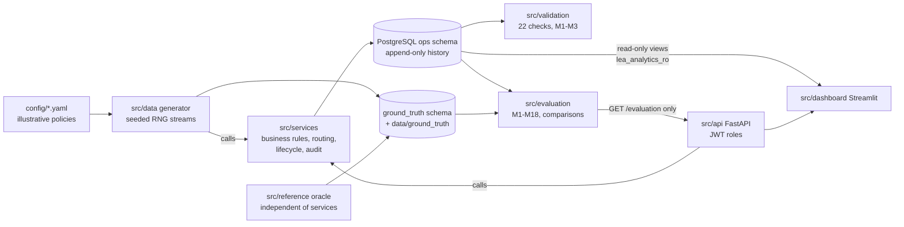

# Enterprise Leave and Expense Approval Automation System

> **ALL DATA IS SYNTHETIC.** Every employee, request, receipt and amount is generated from a fixed seed. All
> policy values (limits, thresholds, approval levels) are ILLUSTRATIVE ASSUMPTIONS, labelled in docs/09, not real
> company policy. Authentication is simulated, not production security.

A deterministic, rules-driven workflow engine for employee leave requests and expense claims: validation against
versioned policies, multi-level approval routing with delegation and substitution, exception handling,
reimbursements and an append-only audit trail. Around it: a seeded synthetic-data generator with planted anomalies,
ground truth in a separate schema, an independent reference oracle, an evaluation suite (metrics M1-M18), a FastAPI
backend and a Streamlit dashboard. Version 1.0.0.

## Architecture



Workflow status, exception class, technical processing status and audit events are separate dimensions. Only
src/evaluation reads ground truth (role lea_evaluation); services never import src/reference (tested).
Details: docs/03_architecture.md.

## Setup (Windows PowerShell)

```powershell
python -m venv .venv
.\.venv\Scripts\Activate.ps1
python -m pip install -r requirements.txt
Copy-Item .env.example .env        # set the passwords and JWT_SECRET (never commit .env)
.\scripts\init_local_db.ps1 -SuperuserPassword "<postgres password>"   # once; or: docker compose up -d
```

macOS / Linux: `python3 -m venv .venv`, `source .venv/bin/activate`, `cp .env.example .env`, and
`docker compose up -d` for the database. Full guide: docs/14_setup.md.

## Run everything

```powershell
.\scripts\run_all.ps1          # migrate, generate --load, validation, both oracle comparisons,
                               # reproducibility check, metrics M1-M18, pytest (stops at the first failure)
.\scripts\start_dashboard.ps1  # API http://localhost:8000/docs (new window) + dashboard http://localhost:8501
```

The individual commands (and the macOS / Linux sequence) are in docs/14_setup.md section 9. Log in with a synthetic
user from data/processed/dev_credentials.csv (written by the generator, git-ignored).

Results of the release run: docs/12_final_evaluation.md (validation 22 / 22 PASS, both oracle comparisons 0
DISAGREE, reproducibility 76 / 76, 17 of 18 metrics measured, M9 not measurable).

## Optional Groq explanation layer

GET /requests/{id}/explanation returns a plain-language explanation of a request. Off by default; enable it in
.env with `LLM_EXPLANATIONS_ENABLED=true` and `GROQ_API_KEY=<your key>` (optional `GROQ_MODEL`; default
`openai/gpt-oss-20b` from config/llm.yaml). Rules: display only, it never changes a decision, status, amount or
route; it sees only the request's own operational facts, never ground truth; nothing is stored, exported or audited;
when the flag is off, the key is empty, or the call fails, times out, is rate-limited or fails the output check, a
template text is returned instead (source "template", with the reason). Details: docs/09 section 14.

## Documents

| File | Content |
|---|---|
| docs/00_original_spec.md, docs/01_amendments.md | source of truth (amendments win on conflict) |
| docs/02_requirements_traceability.md | traceability; section 9 = acceptance matrix (spec 25) |
| docs/03_architecture.md, docs/04_entity_relationships.md | architecture, entities and relationships |
| docs/05_business_rules.md | business rules; approval routing decision table in section 5.2 |
| docs/06_lifecycle_and_audit.md | state machines and audit |
| docs/07_data_generation.md, docs/11_generation_guide.md | generation design and guide (seed, parameters, provenance) |
| docs/08_evaluation_strategy.md | metric definitions M1-M18 and how to read the results |
| docs/09_assumptions_and_decisions.md, docs/19_limitations.md | assumptions, decisions, limitations |
| docs/10_data_dictionary.md | every table, field and analytics view |
| docs/12_final_evaluation.md | validation report and final evaluation (real output) |
| docs/13_dashboard_guide.md, docs/16_api_guide.md | dashboard guide, API usage guide |
| docs/14_setup.md, docs/15_testing.md | setup and testing instructions |
| docs/17_configuration_reference.md, docs/18_troubleshooting.md | configuration reference, troubleshooting |

## Layout

```
config/      illustrative policy and generation configuration
data/        manifest and ground truth (committed); raw, processed, validation (generated, git-ignored)
docs/        specification, amendments, design documents, guides
migrations/  Alembic migrations 0001-0004 (ops and ground_truth schemas, analytics views)
sql/         roles, triggers, grants, test-only constraints, container init scripts
src/         common, models, services, data (generator), reference (oracle), validation, evaluation, api, dashboard
tests/       pytest suites (db tests use the separate lea_test database)
scripts/     setup, run_all, reproducibility check, dashboard start
```

## Known limitations and future work

- Deferred 8B-2 items: resubmission rounds and cancellations are not in the dataset (the services exist and are
  tested); the S11 / S12 / S18 plants (self-approval, unauthorized-approver and repeated-submission attempts); per-round
  ground truth with migration 0005 (ground_truth.record_round_expectation).
- M9 (unauthorized approval detection rate) is not measurable on the dataset because S11 / S12 are not planted.
- No tamper-evident audit hash chain; leave and budget ledger postings have no audit_event rows.
- First submissions accept no Idempotency-Key; a token's roles are not re-checked per request (trusted until expiry).
- No receipt upload through the API.
- Leave utilisation is not shown in the dashboard.
- The business-day variants of M14 and M18 are not computed (calendar days only).
- Every rejection in the dataset is a planted one, so the natural rejection rate is 0.
- 100% detection scores on this synthetic benchmark show that the rules are implemented as documented; they do not
  predict accuracy on real data (docs/12).

Full list with references: docs/19_limitations.md.
